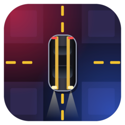

<p align="center">
  
</p>

# Grand Theft Auto 2 Recompiled

A native PC port of *Grand Theft Auto 2* (1999, the PC version) made by **static recompilation**: the game's own
x86 code is translated to C and compiled for your machine, with a Vulkan renderer, SDL3 for input and sound, and
no emulator, no Windows layer and no original DLLs. Windows and Linux, and an
[Android version](https://github.com/almost-drowned-rat/Grand-Theft-Auto-2-Recompiled-Android).

> This project contains **no game data and no game code**. You need GTA 2 yourself: the **2004 Rockstar freeware
> release** (`GTA2.exe`, the installer, about 360 MB) or a GTA 2 you installed from it. The game is translated and
> compiled **on your own PC** from your copy at the first start.

> **AI disclosure:** AI assistance yes (Claude Code by Anthropic).

## Download and play

Download the latest release from [Releases](https://github.com/almost-drowned-rat/Grand-Theft-Auto-2-Recompiled/releases).

- **Windows:** `GTA2-windows-x86_64.zip` - unpack it into an empty folder and start `gta2_launcher.exe` in it (the
  game itself is built into `data\gta2_recomp.exe`; keep starting the launcher). Windows 10 or 11, 64-bit, and a
  Vulkan 1.1 driver. The files are not signed: Windows SmartScreen may ask once ("More info" -> "Run anyway").
- **Linux:** `GTA2-x86_64.AppImage` (make it executable and start it), or `GTA2-linux-x86_64.tar.gz` if you cannot
  use AppImages (no FUSE). Needs glibc 2.35 or newer (Ubuntu 22.04, Debian 12, Fedora 36 or later) and a Vulkan 1.1
  driver.

At the first start the launcher asks for your **GTA 2 installer (`GTA2.exe`)** - or a folder with an **installed
GTA 2** - and, optionally, the **translations pack** (`GTA2-translations.pak`, its own download in the release). It
unpacks the game files, translates `gta2.exe` and the movie decoder to C and compiles them; this takes a few
minutes, once. Later starts go straight into the game. Your installer or folder is only read, never changed.

Everything stays in the game's folder: `game/` (the game's files), `saves/` (your saves and settings), `data/`
(logs, caches - safe to delete), `media/` (your own music), `shader/` (your shader packs). Nothing is written anywhere else.

## Features

- **RECOMP OPTIONS** in the game's own options menu (no separate settings program):
  - **Rendering:** display mode (borderless / fullscreen / windowed), render resolution, texture filtering, frame
    rate, aspect ratio 4:3 / 16:9 / 16:10 / 21:9 (real widescreen: you see more of the city, nothing is stretched;
    menus stay 4:3)
  - **Frame rate:** 30 (original), 60 or 120 interpolated - the game logic keeps its original 30 ticks per second,
    the frames in between are drawn from it, so the game never runs faster
  - **Performance:** V-Sync, FPS counter, frame time, game speed
  - **Shaders:** RetroArch slang shader presets (librashader). Each sub-folder or `.zip` in `shader/` is one pack,
    with its presets (`.slangp`) inside it - loose presets in `shader/` itself are not read. The easiest pack is the
    whole libretro collection: on https://github.com/libretro/slang-shaders choose Code -> Download ZIP and put
    `slang-shaders-master.zip` into `shader/` as it is (it is unpacked once to `data/shaders/`). Then pick a preset
    in RECOMP OPTIONS -> SHADERS -> SHADER SELECTION.
  - **Enhancements:** language, the minimap, a day / night cycle, a manual camera, and the settings of the old
    GTA 2 Manager (pedestrians, traffic, sprint, more blood)
  - **Cheats:** the game's own cheats as switches
- **Minimap:** a radar drawn from the game's own map files - size, zoom and position of your choice, missions and
  gang phones, churches, garages, tokens, weapons, power-ups, kill frenzies and police cars each on their own switch,
  the game's own arrows off / on / near the target, and a map of the whole district with a legend in the pause menu
- **Manual camera** (off by default): a steady camera - one fixed height on foot and in a car (the far view of a fast
  car), no automatic zoom, the car kept in the middle of the screen - zoomed step by step with a button of your choice
  (LT in the modern layout)
- **Day / night cycle** (off by default): day, sunset, night and sunrise over the game's own lighting - the street
  lamps light the city at night, the cars' headlights come on at dusk and go off in the day (sirens and brake lights
  stay), a lamp broken in a crash stays dark; a full day takes 24, 48 or 96 minutes, or set each phase's length
  to the second yourself (a phase at 0:00 is skipped - e.g. only daylight)
- **Save anywhere** (off by default): SAVE GAME in the pause menu (free; not on a job, while wanted, in a car or in
  water) and LOAD GAME in the main menu bring you back exactly where you saved; the church saves work as before
- **Controls:** any SDL3 gamepad with hot-plug and rumble (explosions), a classic and a modern pad layout plus your
  own mapping (the modern layout keeps its right-stick aiming, on foot and in a car mapped apart), three mapping
  profiles beside the stock one, keyboard only or keyboard + mouse, and a keyboard mapping of your own in the same
  layout (on foot and in a car apart); an illustrated controller layout and a control overview
- **Analogue controls** (by maverick-hunter): analogue walking with the stick, analogue gas and brake when they are
  mapped to the triggers, and in ENHANCEMENTS (off by default) ANALOGUE STEERING (with presets, dead zone, curve,
  smoothing), PUNCH (with the weapon put away), TURRET AIM (the right stick) and CAMERA PAN (Select + right stick)
- **Sprint** (ENHANCEMENTS > SPRINT): a short sprint with a stamina bar, two presets, the bar's place of your choice
- **Mods:** every folder in `mods/` is one mod whose files stand in for the game's (graphics, maps, scripts,
  texts, sounds) - nothing in the game's own folder is changed; a folder name starting with `_` switches it off.
  Planned: mods that bring their own code, so new features no longer need a pull request
- **MIXTAPE**, a radio station of your own: put your music (MP3, FLAC, Ogg Vorbis, WAV) into album folders under
  `media/`; it plays on like a radio station after the game's stations. All albums or one, in order or shuffled.
- **Languages:** English and Spanish come with the game. The translations pack adds **German, French, Italian, Polish,
  Russian, Japanese and Chinese** (all game texts; the port's own menus stay English, radio station names stay as
  they are). Pick the language in the game's options.
- Crash-safe saves, a detailed log in `data/gta2.log` (the previous run in `gta2.previous.log`)

## Supported version

| Release | File | `gta2.exe` SHA-1 |
|---|---|---|
| Rockstar freeware release (2004, build 2004-04-27) | `GTA2.exe` installer, about 360 MB | `646e1d479fa2aea12b3ff448fa23f6362f9e012f` |

## Building from source

The port: `src/` (game-specific code), the toolkit [winrecomp](https://github.com/almost-drowned-rat/winrecomp)
(runtime, Win32 layer, lifter) beside it as `../winrecomp`. Linux:

```sh
python3 tools/setup_build.py extract --installer GTA2.exe --unshield "$(command -v unshield)" --work work --game run/game
python3 tools/setup_build.py lift --game run/game --toolkit ../winrecomp --config config --work work
# or tools/lift.sh / tools/lift.sh bink with the toolkit's Python venv (capstone, pefile)
cmake -S . -B build -G Ninja && ninja -C build
WR_ROOT=run build/gta2_recomp
```

Windows: the same steps with [llvm-mingw](https://github.com/mstorsjo/llvm-mingw) (`clang` on PATH), CMake, Ninja,
the SDL3 mingw development files (`-DCMAKE_PREFIX_PATH=<SDL3-devel>/x86_64-w64-mingw32`) and the Vulkan SDK's
headers (`VULKAN_SDK`); `unshield.exe` for the installer step. `SDL3.dll` goes beside the built exe.

The release packaging: `docs/linux_release.md`, `docs/windows_release.md`. Generated C, game files and builds are
never committed.

## Contributors

- [maverick-hunter](https://github.com/maverick-hunter) - ANALOGUE CONTROLS (analogue steering and pedals, turret aim,
  camera pan, stamina sprint; pull request #7), and the shader report that found the Windows crash (issue #4)

## Thanks

- Rockstar Games for releasing GTA 2 as freeware
- [SDL](https://libsdl.org), [librashader](https://github.com/SnowflakePowered/librashader),
  [capstone](https://www.capstone-engine.org), [pefile](https://github.com/erocarrera/pefile),
  [unshield](https://github.com/twogood/unshield), dr_libs, stb_vorbis, Noto fonts

Licence: MIT for the port (the Linux launcher GPL-3.0) - see `LICENSES.md`.

Grand Theft Auto and GTA are trademarks of Take-Two Interactive Software. This project is not affiliated with or
endorsed by Rockstar Games or Take-Two Interactive.
